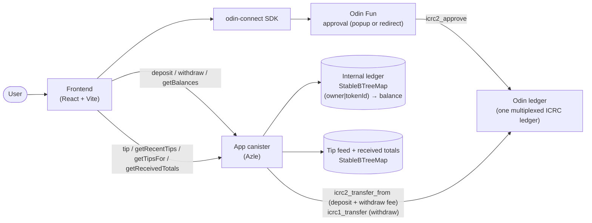

# Odin Tip Jar

A tip jar for **Odin Fun** users, built on
[odin-app-template](https://github.com/Toniq-Labs/odin-app-template). Deposit
Odin tokens once into the app canister, then tip any other Odin user
instantly and fee-free — tips move internal balance between users inside the
canister, so no Odin ledger transfer (and no network fee) is involved. Every
user gets a shareable tip jar page (`/?jar=<principal>`), and a public feed
shows the latest tips.

The template's deposit / withdraw rails and hardened ledger core are kept
unchanged; the tip feature is layered on top. See [Tipping](#tipping).

## Stack

- **Canister**: [Azle](https://github.com/demergent-labs/azle) (TypeScript, Internet Computer)
- **Frontend**: React + TypeScript + Vite, [odin-connect](https://www.npmjs.com/package/odin-connect) SDK (2.x, state store — see [Odin Connect in the frontend](#odin-connect-in-the-frontend))
- **Tooling**: dfx, pnpm workspace

## Architecture



**Deposit**: the user approves the app canister as an ICRC-2 spender through the
Odin Fun approval page (a popup, or a full-page redirect in wallet in-app
browsers); once the approval's result is in the odin-connect state, the canister then pulls the approved funds itself
(`icrc2_transfer_from` on the Odin ledger) and credits the user's internal
balance. It is permissionless and self-verifying — a credit is only recorded for
funds that actually settled into the canister.

**Withdraw**: the user calls `withdraw`; the canister debits the internal
balance (persisted *before* the transfer await), pulls the BTC ledger fee from
the withdrawer (`icrc2_transfer_from`, see [Withdrawal fees](#withdrawal-fees)),
then sends the tokens back out on the Odin ledger (`icrc1_transfer`), refunding
the debit on failure.

**Tip**: the user calls `tip(to, tokenId, amount)`; the canister debits the
caller's internal balance and credits the recipient's, records the tip in a
bounded public feed and adds it to the recipient's lifetime received total.
No Odin ledger call is made, so there is no fee. The call is synchronous (no
`await`), which makes it atomic: a failure anywhere rolls back every write.

## Odin Connect in the frontend

The frontend uses [odin-connect](https://www.npmjs.com/package/odin-connect)
**2.x**, which delivers every result — a connect, an ICRC-2 approval, a buy —
through **one state store** instead of only through the promise returned by the
call. That is what makes the app work inside wallet in-app browsers (OKX,
Xverse, …): there the SDK's default `mode: "auto"` navigates the tab to Odin
and back, the page reloads, and an awaited promise from before the reload never
returns. In normal browsers it uses popups; the app code is the same.

The pattern, as wired in this template:

1. **One instance per page load**, created at module level:
   [`src/odin/client.ts`](packages/frontend/src/odin/client.ts). Never one per
   render or per route.
2. **Render from state** with `useSyncExternalStore(odin.subscribe,
   odin.getState, odin.getServerState)`:
   [`src/odin/useOdinState.ts`](packages/frontend/src/odin/useOdinState.ts).
   `state` is `{ status, user, request }`; `status` is `"initializing"` until
   the stored session (and any returning redirect result) has been applied.
   [`OdinConnectProvider`](packages/frontend/src/odin/OdinConnectProvider.tsx)
   derives the UI's auth status from it
   ([`authStatus.ts`](packages/frontend/src/odin/authStatus.ts)) — there is no
   `restoreSession()` call.
3. **Start things from buttons, don't await them.** `odin.connect(…)` and
   `user.icrcApprove(…)` are fire-and-forget; their outcome arrives as
   `state.request` (`{ id, action, status, input, returnState?, error? }`,
   `status` one of `pending | success | rejected | failed | unverified`).
4. **React to `request` for the follow-up step.**
   [`DepositForm`](packages/frontend/src/components/DepositForm.tsx) and
   [`WithdrawForm`](packages/frontend/src/components/WithdrawForm.tsx) each have
   an effect that, when *their* `icrc_approve` request is `success`, calls the
   canister (`deposit` / `withdraw`). Rules they follow
   ([`approvalFlow.ts`](packages/frontend/src/odin/approvalFlow.ts)):
   - read call arguments from `request.input`, not from form state (gone after
     a redirect); put anything else the next step needs in `returnState`
     (JSON, bigints allowed) — withdraw carries the token + amount there, since
     its approval is for the BTC fee;
   - tag each flow's `returnState` (`{ flow: 'deposit' }`) so two flows that
     start the same action don't both react;
   - run a value-moving follow-up **at most once per `request.id`** (claimed
     before the call), because effects re-run and a settled request stays in
     state;
   - never treat `success` as proof: the canister's `icrc2_transfer_from` is the
     on-chain check of the allowance;
   - never call `connect()` automatically after a `rejected` / `unverified`
     connect — in redirect mode that loops the user back to Odin; show the
     Connect button (retry) instead.

Consequences for your fork:

- Code that reads `location.search` on load must read it after
  `await odin.ready()` (Odin returns to the page path without the query; the
  SDK restores it). The template's only such reader, `?lang=`, is consumed and
  stripped before any connect can start, so it is unaffected.
- If you add a Content-Security-Policy, `connect-src` must allow
  `https://api.odin.fun` — every connect is verified there.
- Do not add open-redirect pages (`/go?to=…`, `/redirect/<url>`) on your
  origin: redirect mode with `requires_api` / `requires_delegation` relies on
  Odin only returning to your own pages.
- To test the redirect path in a desktop browser, run `odin.mode = "redirect"`
  in the console (or construct with `mode: "redirect"` temporarily). Use
  `https://` or `http://localhost`.

Upgrading an older fork (odin-connect 1.6/1.7)? Follow the SDK's
[migration guide](https://github.com/Toniq-Labs/odin-connect/blob/main/MIGRATION-2.0.md)
(shipped in the package as `node_modules/odin-connect/MIGRATION-2.0.md`) and the
[readme](https://github.com/Toniq-Labs/odin-connect#readme) ("State and
sessions", "Wallet in-app browsers").

## Layout

```
packages/
  canister/   # Azle canister — internal multi-token ledger
  frontend/   # Vite + React app — Odin Connect auth + deposit/withdraw/tip UI
dfx.json      # canister (azle) + frontend (asset) canister config
```

## Prerequisites

- [Node.js](https://nodejs.org) 22+ (see `.nvmrc`)
- [pnpm](https://pnpm.io) 10+
- [dfx](https://internetcomputer.org/docs/current/developer-docs/getting-started/install) 0.31+
- [Rust](https://www.rust-lang.org/tools/install) + `wasm32-unknown-unknown` target (required by Azle)

```sh
rustup target add wasm32-unknown-unknown
```

## Quick start

```sh
pnpm install          # install workspace deps (auto-installs the azle dfx extension if dfx is on PATH)
dfx start --clean --background
dfx deploy            # build + deploy canister and frontend
```

> If `pnpm install` ran before `dfx` was installed, register the azle dfx extension manually:
>
> ```sh
> pnpm --filter @odin-tip-jar/canister exec azle extension install
> ```

Frontend dev server:

```sh
pnpm dev:frontend
```

## Scripts

| Command                | Description                          |
| ---------------------- | ------------------------------------ |
| `pnpm build`           | Build all workspace packages         |
| `pnpm build:canister`  | Build the Azle canister              |
| `pnpm build:frontend`  | Build the frontend                   |
| `pnpm dev:frontend`    | Start the Vite dev server            |
| `pnpm typecheck`       | Type-check all packages              |
| `pnpm test`            | Run unit tests (ledger, tips, frontend helpers) |

## Canister API

| Endpoint        | Kind   | Description                                                        |
| --------------- | ------ | ----------------------------------------------------------------- |
| `deposit`       | update | Pull pre-approved funds from the Odin ledger and credit the caller. |
| `withdraw`      | update | Debit the caller's balance and send tokens back via the Odin ledger. |
| `getBalance`    | query  | Caller's internal balance for one token.                          |
| `getBalances`   | query  | All of the caller's `(token, balance)` pairs.                     |
| `getOwner`      | query  | The configured owner principal, or empty if not yet initialized.  |
| `tip`           | update | Move `amount` of `tokenId` from the caller's internal balance to `to`'s. Fee-free, synchronous, logged. Rejects anonymous callers/recipients and self-tips. Returns the caller's new balance. |
| `getRecentTips` | query  | The latest tips across all users, newest first (`limit`, max 500). |
| `getTipsFor`    | query  | The latest tips received by a principal, newest first.            |
| `getReceivedTotals` | query | Lifetime `(token, total)` pairs a principal has received via tips. Exact regardless of feed eviction. |
| `icrc28_trusted_origins` | update | [ICRC-28](https://github.com/dfinity/wg-identity-authentication) trusted origins — the web origins allowed to request signed calls. Odin Connect calls this before issuing a delegation and refuses auth if your app's origin is not listed. |

> **ICRC-28 / Odin Connect auth:** the trusted origins are configured in
> `TRUSTED_ORIGINS` in
> [`packages/canister/src/index.ts`](packages/canister/src/index.ts). Each entry
> must be a bare origin (`scheme://host[:port]`, no trailing slash, no path);
> https only, except `http://localhost` in dev. The signer does an exact string
> match. **Edit this list to your deployed frontend origin before going live** —
> a wrong or missing origin fails login silently. It must be `update` (not
> `query`): the signer issues a replicated call so the response is certified.

Tokens are identified by their **Odin token id** (text), not an ICRC ledger
principal — every Odin token shares one ledger and is addressed by subaccount
(`odin_token_pointer`). Balances are keyed by `(owner, tokenId)` and stored in
stable memory, so they survive upgrades.

### Tipping

`tip` is the only balance-moving endpoint added on top of the template. It is
built *around* the hardened ledger core, not inside it: it composes the
existing `validateAmount` / `debit` / `credit` helpers from
[`packages/canister/src/ledger.ts`](packages/canister/src/ledger.ts), so it can
never create balance — `deposit` remains the only mint path. Party checks and
feed bookkeeping live in the pure, unit-tested
[`packages/canister/src/tips.ts`](packages/canister/src/tips.ts).

Rules enforced by the canister:

- the caller must not be anonymous (no balance, no identity to log);
- the recipient must not be the anonymous principal (it can never withdraw);
- you cannot tip yourself;
- the caller is debited (and the debit persisted) **before** the recipient is
  read and credited;
- no `await` inside `tip` — adding a cross-canister call would break its
  atomicity. Keep it synchronous.

**Public feed.** Tips are stored in a bounded log of the latest **500** tips;
older entries are evicted. The feed is a UX feature, not an audit trail — the
per-recipient totals (`getReceivedTotals`) are kept in a separate map and stay
exact forever. Tip records (sender, recipient, token, amount, time) and totals
are public by design.

**Stable memory ids**: `0` ledger · `1` config · `2` tip feed · `3` received
totals. Never reuse or renumber an id.

### Tip jar links (`?jar=`)

Every user's tip jar lives at `/?jar=<principal>`. The page shows the Odin
profile (username, avatar), lifetime received totals, that user's recent tips,
and — when the visitor is connected — a tip form locked to that recipient. It
renders while logged out: public reads go through an anonymous actor
([`createAnonymousActor`](packages/frontend/src/canister/actor.ts)), which is
never used for `tip` / `deposit` / `withdraw`.

Two rules from the template still apply:

- the param is read only once odin-connect has finished restoring
  (`status !== 'restoring'`), because after a redirect-mode connect the SDK
  restores the original query string in `ready()` — see
  [`src/App.tsx`](packages/frontend/src/App.tsx);
- it is called `jar`, not `to` / `redirect`, and is only ever validated as a
  principal (never used as a navigation target), so it cannot become an open
  redirect. See [`src/lib/jar.ts`](packages/frontend/src/lib/jar.ts).

### Withdrawal fees

transfer. On withdraw the sender is the app canister, so the canister pays that
fee in BTC.

This template makes the **withdrawer pay** the fee — no maintainer-funded float,
not griefable. The flow:

1. On withdraw the frontend requests an ICRC-2 BTC approval (`icrcApprove`,
   token `"btc"`) for **2× the fee**.
2. `withdraw` pulls the fee from the caller's BTC (`icrc2_transfer_from`), then
   sends the tokens. The pulled BTC funds the outbound transfer's own fee, so on
   success the canister **nets zero BTC and needs no float**. If the token send
   fails after the fee pull, the fee is forfeited (not refunded — returning it
   would cost another BTC transfer), leaving the canister a small BTC surplus.

Why 2×: pulling BTC is itself a transfer, and the ledger charges the caller a
fee on that pull too (debited from `from`, per ICRC-2). So the withdrawer pays
the fee twice — once for the pull, once funding the send — and the approval must
cover both. See `ODIN_BTC_FEE` in
[`packages/canister/src/odin.ts`](packages/canister/src/odin.ts) and
[`packages/frontend/src/lib/fees.ts`](packages/frontend/src/lib/fees.ts).

> **Verify before mainnet:** `ODIN_BTC_FEE` is set to the documented 100 sats.
> Confirm it matches the live ledger fee — too low traps the first withdraw with
> `error 910`; too high leaves the canister a small BTC surplus.

## Deploy to mainnet

The reference deployment's backend canister is `v7drs-jyaaa-aaaaf-qhaca-cai`
(network `ic`).

1. Make sure you have a cycles-funded identity (`dfx identity get-principal`,
   then fund it with cycles — see the
   [cycles docs](https://internetcomputer.org/docs/current/developer-docs/getting-started/cycles/cycles-wallet)).

2. Build and deploy to the IC:

   ```sh
   pnpm build                       # frontend dist + canister type check
   dfx deploy --network ic          # deploy canister + frontend asset canister
   ```

   Canister creation costs 0.5 TC each, so on a small cycles balance deploy
   only the backend and host the static frontend elsewhere:

   ```sh
   dfx deploy canister --network ic --with-cycles 1000000000000
   ```

   A [`netlify.toml`](netlify.toml) is included for Netlify: it builds
   `packages/frontend` and publishes `dist`. Set `VITE_APP_CANISTER_ID`,
   `VITE_DFX_NETWORK=ic` and `VITE_ODIN_ENV=prod` in the site's environment
   variables (they are baked into the bundle at build time), then put the
   Netlify origin in `TRUSTED_ORIGINS` (step 5).

3. The deploying principal is recorded as the **owner** (see `@init` in
   [`packages/canister/src/index.ts`](packages/canister/src/index.ts)) — a
   generic admin handle for any admin-gated endpoints you add later. Deposits are
   **not** owner-gated: `deposit` is permissionless and self-verifying (it pulls
   the caller's own pre-approved funds before crediting), so no trusted minter is
   needed.

4. Note the canister IDs printed on deploy; the frontend reads them from the
   generated `.env` (`output_env_file` in `dfx.json`). Mainnet ids are written
   to `canister_ids.json`, which is gitignored by default — keep a copy (or
   remove it from `.gitignore`) or dfx will create a new canister next time.

5. **Set your trusted origins.** Edit `TRUSTED_ORIGINS` in
   [`packages/canister/src/index.ts`](packages/canister/src/index.ts) to the
   origin your frontend is served from (e.g. your asset-canister URL or custom
   domain), then redeploy. Odin Connect login fails until your origin is listed.
   Verify with:

   ```sh
   dfx canister call canister icrc28_trusted_origins '()' --network ic
   ```

6. **No canister BTC float needed** for withdrawals — the withdrawer pays the
   Odin ledger fee at withdraw time (see [Withdrawal fees](#withdrawal-fees)).
   Just confirm `ODIN_BTC_FEE` matches the live ledger fee before going live.

## How to extend

**Add support for a new token** — no code change needed. Tokens are identified
by their Odin token id (text); pass the id to `deposit` / `withdraw` / `tip` /
`getBalance`. The ledger keys every balance by `(owner, tokenId)`, so new tokens
work out of the box.

**Add a new canister endpoint** — add a `@query` / `@update` method in
[`packages/canister/src/index.ts`](packages/canister/src/index.ts). ⚠️ Add code
*around* the hardened ledger core, never inside the `BEGIN/END HARDENED LEDGER
CORE` markers in
[`packages/canister/src/ledger.ts`](packages/canister/src/ledger.ts). See
[`CLAUDE.md`](CLAUDE.md) for the full guardrails.

**Frontend changes** — UI, components, and styling under
[`packages/frontend/src`](packages/frontend/src) are free to modify. Auth and
flows are built on the [odin-connect](https://www.npmjs.com/package/odin-connect)
SDK — render from its state, never from an awaited call (see
[Odin Connect in the frontend](#odin-connect-in-the-frontend)).

**Add a language (i18n)** — the frontend is localized with
[react-i18next](https://react.i18next.com/). English (`en`) is the default and
the source of truth for keys; Simplified Chinese (`zh`) ships alongside it.
Locale detection is `?lang=` query param → `localStorage` → browser language →
`en`, and the choice persists across reloads. To add a locale (e.g. Japanese,
`ja`):

1. Copy [`src/i18n/locales/en.json`](packages/frontend/src/i18n/locales/en.json)
   to `src/i18n/locales/ja.json` and translate the values (keep the keys).
2. In [`src/i18n/index.ts`](packages/frontend/src/i18n/index.ts): import the new
   catalog, add it to `resources`, and add `'ja'` to `SUPPORTED_LOCALES`.
3. Add a `language.ja` label to every locale catalog (the switcher labels each
   option with `t('language.<locale>')`).

`en.json` is the key source of truth: every other catalog is checked against it
at compile time (a missing or misspelled key fails `pnpm typecheck`), so keep
the key sets identical. The switcher in
[`src/components/LanguageSwitcher.tsx`](packages/frontend/src/components/LanguageSwitcher.tsx)
renders one option per `SUPPORTED_LOCALES` entry automatically.

**Share a language via URL (`?lang=`)** — opening the app with `?lang=zh` (or
`?lang=en`) applies that language as if the user had picked it in the switcher:
it is persisted to `localStorage` and the param is stripped from the URL so a
stale link can't override a later in-app choice. Regional variants map to their
base language (`zh-CN` → `zh`); unsupported values are ignored. See
[`src/i18n/locale.ts`](packages/frontend/src/i18n/locale.ts).

**Language in the Odin Connect pages** — the app forwards its active locale to
the [odin-connect](https://www.npmjs.com/package/odin-connect) SDK via its
runtime `lang` setter, on mount and whenever the user switches language, so
sign-in and canister-action pages (popup or redirect) open in the app's current
language without a reload. See
[`src/odin/OdinConnectProvider.tsx`](packages/frontend/src/odin/OdinConnectProvider.tsx).
